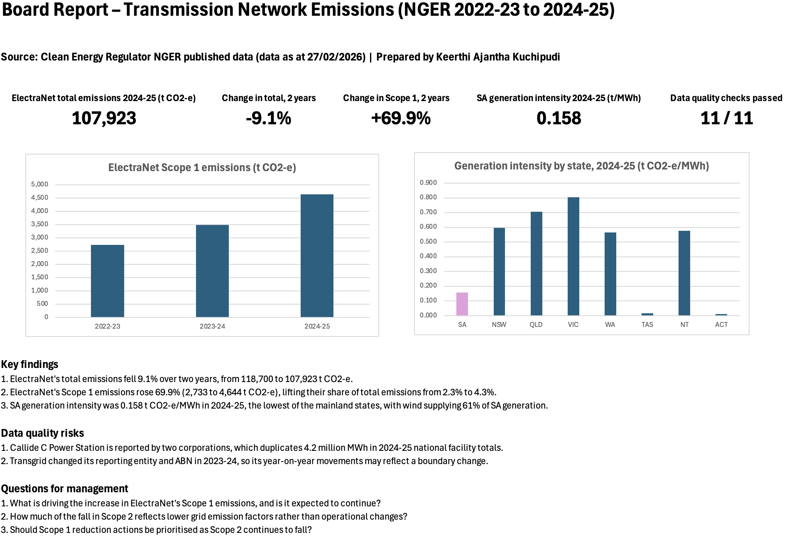
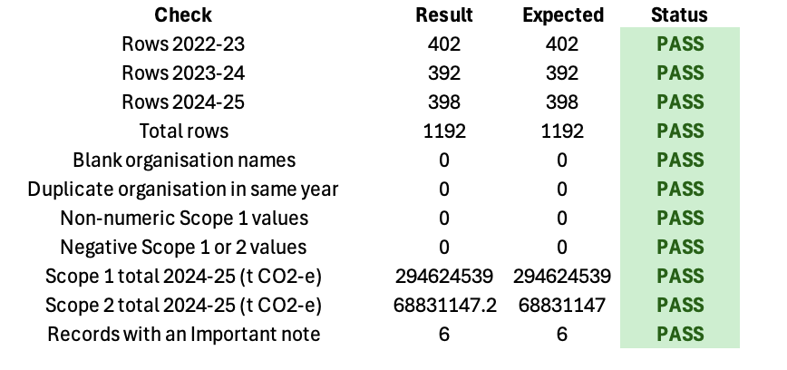
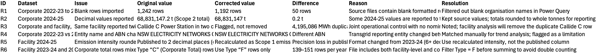

# NGER Emissions Reporting & Data Assurance – Transmission Networks (2022-23 to 2024-25)

An Excel model that collects, validates, reconciles and reports greenhouse gas emissions data published under the National Greenhouse and Energy Reporting (NGER) scheme, with a focus on ElectraNet and South Australia's electricity sector.

## Purpose

To demonstrate an end-to-end sustainability reporting workflow: collecting official emissions data, assuring its quality, explaining movements with evidence, and presenting decision-focused insights in a one-page Board report.

## Key Findings

| Metric | Result |
|---|---|
| ElectraNet total emissions 2024-25 | 107,923 t CO2-e |
| Change in ElectraNet total emissions (2 years) | -9.1% |
| Change in ElectraNet Scope 1 emissions (2 years) | +69.9% |
| SA generation intensity 2024-25 (Scope 1) | 0.158 t CO2-e/MWh |
| Data quality checks passed | 11 / 11 |

1. ElectraNet's total emissions fell 9.1% over two years, from 118,700 to 107,923 t CO2-e.
2. ElectraNet's Scope 1 emissions rose 69.9% (2,733 to 4,644 t CO2-e), lifting their share of total emissions from 2.3% to 4.3%.
3. SA generation intensity was 0.158 t CO2-e/MWh in 2024-25, the lowest of the mainland states, with wind supplying 61% of SA generation.

Findings report what changed. Where the dataset does not explain a movement, the cause is raised as a question for management rather than assumed.

## Data Sources

All data is published by the Clean Energy Regulator (CER):

| Dataset | Years | Data as at |
|---|---|---|
| Greenhouse and energy information by registered corporation | 2022-23, 2023-24, 2024-25 | 28/02/2024, 28/02/2025, 27/02/2026 |
| Greenhouse and energy information by designated generation facility | 2023-24, 2024-25 | 28/02/2025, 27/02/2026 |

Each source is recorded in the Source_Register sheet with its publisher, reporting year, publication date and download date, providing a clear evidence trail.

## Model Structure

| Sheet | Purpose |
|---|---|
| Board_Report | One-page summary: KPIs, key findings, data quality risks, questions for management, charts |
| Source_Register | Evidence trail for every dataset used |
| Data_QA | 11 automated checks (row counts, blanks, duplicates, non-numeric and negative values, totals reconciled to source) |
| Reconciliation_Log | Six data issues found, with original value, corrected value, reason and resolution |
| Company_Trends | ElectraNet vs Transgrid, Powerlink and TasNetworks: Scope 1, Scope 2 and total emissions, year-on-year change, findings and evidence |
| SA_Generation_Intensity | Generation intensity by state and SA fuel mix |
| Limitations | Reporting boundaries and constraints affecting interpretation |
| Combined_Corporate, Facilities | Cleaned data combined with Power Query |

## Data Assurance Highlights

Issues identified and resolved include:
- **50 blank formatted rows** imported from the source files, removed in Power Query
- **Callide C Power Station reported by two corporations**, duplicating 4.2 million MWh in 2024-25 national facility totals
- **Transgrid changed its reporting entity name and ABN** in 2023-24, which would break a simple year-on-year match
- **Published intensity rounded to two decimals** in 2024-25, so intensity was recalculated
- **Corporate total rows mixed with facility rows**, filtered to avoid double counting

## Definitions

- **Scope 1 emissions:** direct emissions from sources a company owns or controls (e.g. fuel combustion, gas leaks).
- **Scope 2 emissions:** indirect emissions from the electricity a company purchases or consumes.
- **Generation intensity:** Scope 1 emissions divided by electricity production (t CO2-e/MWh), following the CER definition.
- **NGER:** Australia's national framework requiring corporations above set thresholds to report greenhouse gas emissions, energy production and energy consumption.

## Limitations

- NGER data covers only corporations above the reporting thresholds.
- Scope 2 emissions depend on grid emission factors, which change each year.
- Reporting entities can change name, ABN or boundary between years.
- Some facilities are reported by more than one corporation.
- Only three corporate years and two facility years are analysed.
- The dataset does not explain why emissions changed.

## Tools

Excel: Power Query (combine, clean, append), SUMIFS, COUNTIFS, structured table references, data validation checks, conditional formatting, charts.
